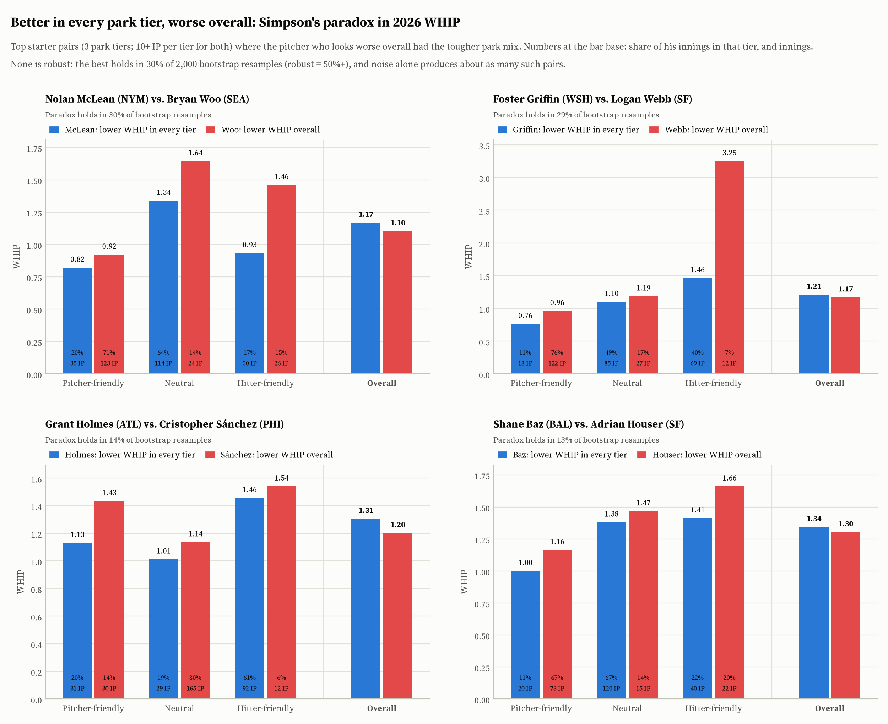
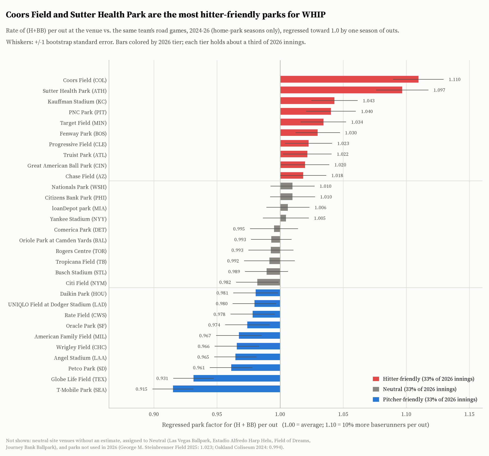
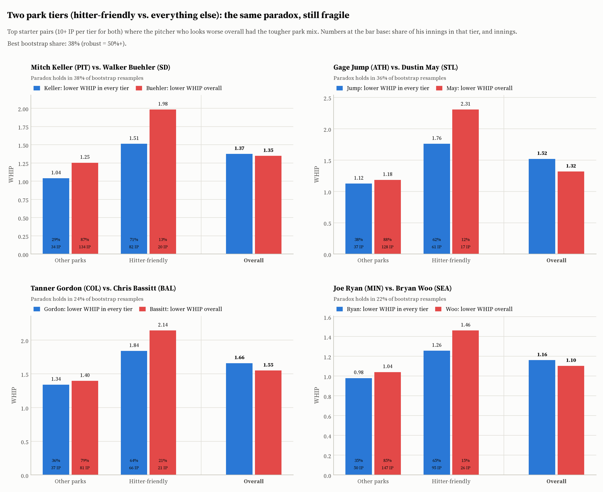
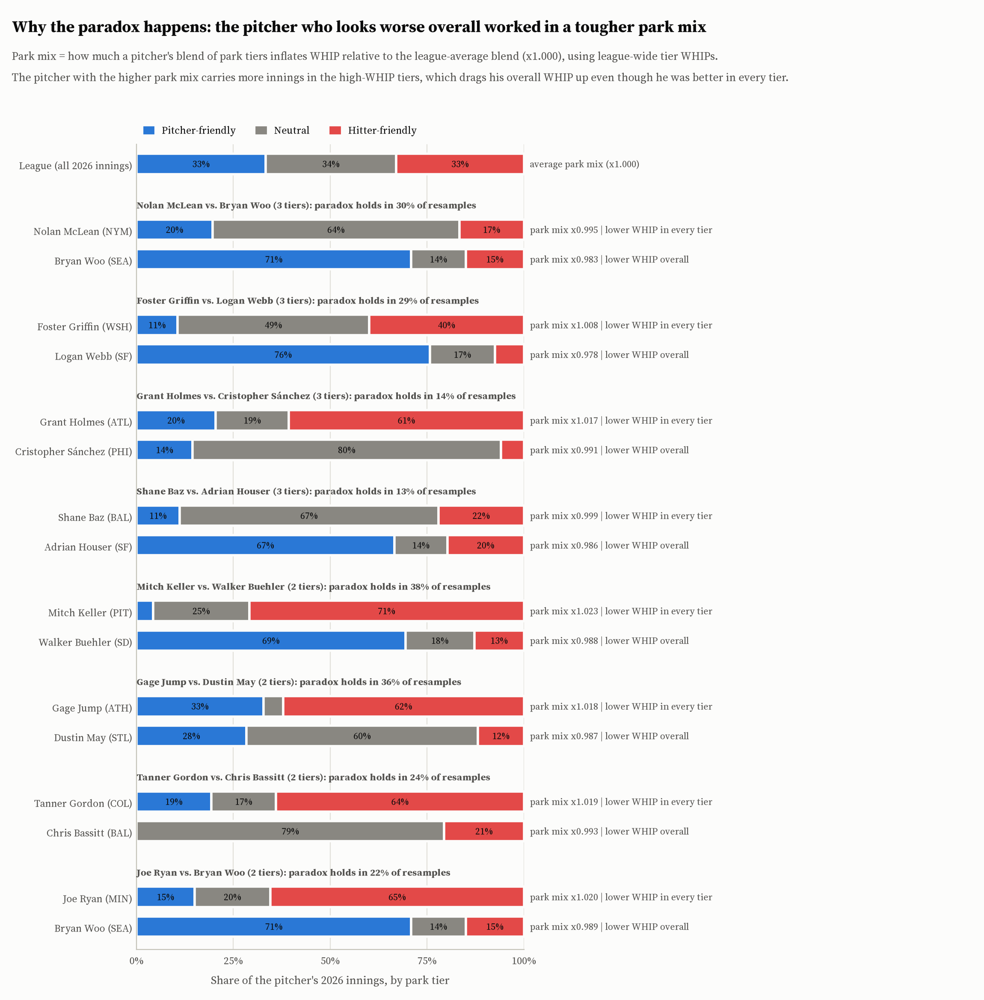
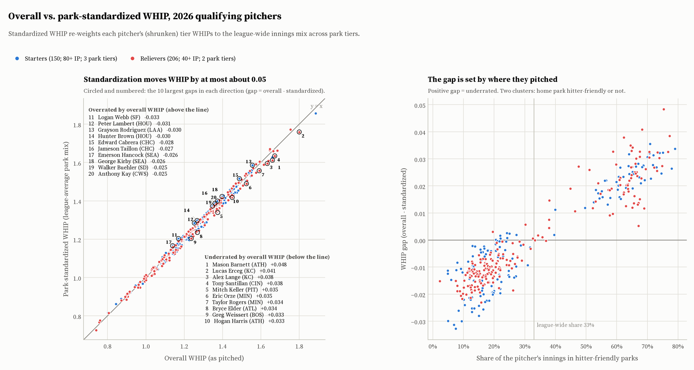
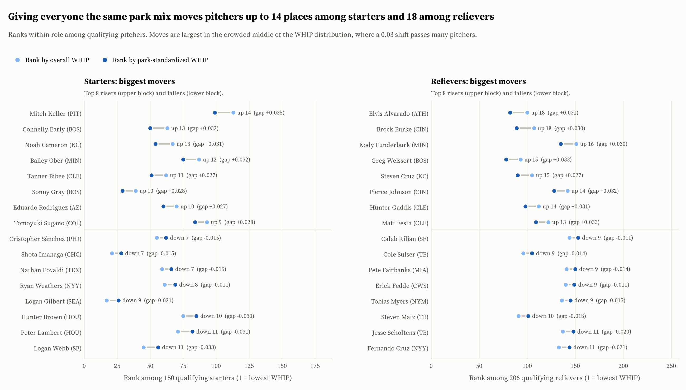

# WHIP and Simpson's Paradox by Ballpark: 2026 MLB Regular Season

Does a pitcher's WHIP misrepresent him because of *where* he pitched? This project splits every
2026 inning by the kind of ballpark it was thrown in. It then looks for **Simpson's-paradox
pairs**: pitcher A has a lower WHIP than pitcher B in every park tier, yet a higher WHIP overall.
Finally, it re-computes every qualifying pitcher's WHIP on the **same, league-average mix of
parks**.

WHIP = (H + BB) / IP. BB includes intentional walks; HBP is not included.

## Key findings

- **Simpson's paradox shows up, but no single pair is robust.** Among 150 qualifying starters,
  54 pairs have one pitcher with the lower WHIP in all three park tiers and the higher WHIP
  overall. The best of them, Nolan McLean vs. Bryan Woo, holds in only 30% of bootstrap
  resamples. Shuffling which park tier each game was played in produces just as many pairs (53 on
  average). With two tiers, or for relievers, no pair reaches the 50% robustness bar either. The
  best is 38%: Mitch Keller vs. Walker Buehler.
- **Parks still decide which way the reversals go.** In 81% of those 54 starter pairs, the pitcher
  who looks worse overall worked in the tougher park mix. With shuffled park labels the figure is
  49% (p ≈ 0.005). So the paradox is real as a *pattern*, even though every individual case is
  within noise.
- **Park-standardizing WHIP moves it by at most about 0.05.** The standard deviation is 0.018 for
  starters and 0.017 for relievers. That is enough to move pitchers up to 14 places among 150
  starters and 18 among 206 relievers.
  - *Underrated* pitchers mostly have hitter-friendly home parks. Mitch Keller (PIT) goes from
    1.375 to 1.339, and reliever Mason Barnett (ATH) from 1.660 to 1.612.
  - *Overrated* pitchers mostly have pitcher-friendly homes. Logan Webb (SF) goes from 1.170 to
    1.203.
- **Coors Field and Sutter Health Park (the Athletics' Sacramento home) are the most
  hitter-friendly parks** for baserunners per out, at +11% and +10% after regression. T-Mobile
  Park (−8.5%) and Globe Life Field (−7%) are the most pitcher-friendly.

## Simpson's paradox in one real example

Two-tier version, where "hitter-friendly" is the top third of parks by park factor:

| 2026 | Hitter-friendly parks | All other parks | **Overall** |
|---|---|---|---|
| Mitch Keller (PIT) | **1.51** WHIP in 82.0 IP (71% of his innings) | **1.04** in 33.2 IP (29%) | 1.375 in 115.2 IP |
| Walker Buehler (SD) | 1.98 in 19.2 IP (13%) | 1.25 in 134.0 IP (87%) | **1.347** in 153.2 IP |

*(IP in baseball notation: 33.2 = 33⅔ innings.)*

Keller allowed fewer baserunners per inning than Buehler in hitter-friendly parks **and** in all
other parks, yet his overall WHIP is higher. Overall WHIP is an innings-weighted average of the
two columns:

- **Keller:** 71% of his innings came in hitter-friendly parks (PNC Park is one), where everyone
  allows more baserunners. His average leans toward the tough column.
- **Buehler:** only 13% of his innings did, because Petco Park is pitcher-friendly. His average
  leans toward the easy column.

A comparison that holds inside every group reverses when the groups are pooled, because the two
pitchers' innings are mixed across the groups in different proportions. That is Simpson's
paradox.

Even this best two-tier pair holds in only 38% of bootstrap resamples. Buehler's 1.98 rests on
19⅔ innings. See [Results](#paradox-pairs).



## Data

| Source | What | Notes |
|---|---|---|
| Baseball Savant via `pybaseball.statcast()` | Pitch-level Statcast data, 2024–2026 | Pulled in weekly chunks and cached as parquet in `data/raw/`; `pybaseball.cache.enable()` on |
| Baseball Savant CSV endpoint (direct) | Fallback | pybaseball's connection was reset once, on the 2024-09-04 to 09-10 chunk. That week (27,090 pitches, 93 games) was pulled day by day from the CSV endpoint. |
| MLB Stats API (`statsapi.mlb.com`) | Season calendars, schedules with venue and final linescore per game, official pitching lines, player names, team abbreviations | Cached JSON in `data/raw/mlb_api/` |
| Chadwick register via `pybaseball.playerid_reverse_lookup` | MLBAM ID to player | Matched 853 of 868 pitchers. The 15 pitchers not yet in the register were named from the MLB Stats API, which also supplies exact display spelling and accents. |

**Season window.** The MLB Stats API gives the 2026 regular season as **March 25 to September 27,
2026**, matching the project spec, and the first and last `game_date` in the data match too. Only
`game_type == "R"` rows are used. That excluded 20,583 spring-training pitch rows from the 2024
pulls, 29,552 from 2025, and none from 2026.

| Season | Regular-season pitches | Games in Statcast | Completed games on the schedule |
|---|---|---|---|
| 2026 | 716,792 | 2,429 | 2,429 (2,430 scheduled; BAL @ NYY on Sept 27 was cancelled) |
| 2025 | 712,528 | 2,430 | 2,430 |
| 2024 | 711,899 | 2,429 | 2,429 (1 cancelled) |

Every completed game is present, so no game is missing.

Pitcher-level analysis uses 2026 only. 2024–2025 are used only for park factors.

## Methods

### 1. Venue for every game (`src/venues.py`)
Every `game_pk` is mapped to the venue in the MLB schedule, not to `home_team`. Venue IDs are the
unit, so renamed parks keep their identity:

- Minute Maid Park became Daikin Park.
- Guaranteed Rate Field became Rate Field.
- Dodger Stadium became UNIQLO Field at Dodger Stadium.

A team's **home park** in a season is the venue where it played most of its designated home games:

- The Rays used Tropicana Field in 2024 and 2026, and George M. Steinbrenner Field in 2025.
- The Athletics used Oakland Coliseum in 2024 and Sutter Health Park in 2025–26.

A game anywhere else is **neutral-site**. There were 8 such games in 2024, 4 in 2025 and 11 in
2026. The 2026 ones:

- Six Athletics "home" games at Las Vegas Ballpark.
- Two D-backs–Padres games in Mexico City.
- Field of Dreams.
- The Little League Classic in Williamsport.
- The Red Sox's September 27 home game, played at Tropicana Field.

Neutral-site games are excluded from park factors but stay in pitcher totals. A neutral site that
is someone's regular park (Tropicana) takes that park's tier. The four venues that were never a
home park get no park factor and go to the **Neutral** tier; they hold 0.4% of 2026 innings.

### 2. Outs, hits and walks per pitcher (`src/attribution.py`)
Outs are not counted from plate-appearance `events`. That would miss caught stealing, pickoffs and
other baserunning outs. Instead:

1. **Order the pitches.** Sort by `game_pk`, `inning`, half (Top before Bot), `at_bat_number`,
   `pitch_number`.
2. **Credit outs between pitches.** Within a half-inning, the outs recorded on or after a pitch
   equal the next pitch's `outs_when_up` minus this pitch's `outs_when_up`. They are credited to
   the `pitcher` who threw the earlier pitch.
3. **Close each half-inning.** The last pitch is credited (outs at the end of the half-inning)
   minus `outs_when_up`. That end count is 3, except in a game's **final** half-inning. Walk-offs,
   including extra-inning walk-offs with the automatic runner, and weather-shortened games can
   end with fewer outs. For that half-inning the end count comes from the **official final
   linescore** (MLB Stats API `linescore.outs`); 204 of 2,429 games in 2026 ended with fewer than
   3 outs. One rain-called game had no pitch thrown in its last official half-inning; the code
   detects that and closes the previous half-inning normally. Outs recorded before the first pitch
   of a half-inning (an automatic runner picked off) go to the pitcher who threw that first pitch.
4. **Hits and walks.** Hits are `events` in {single, double, triple, home_run}. Walks are `events`
   in {walk, intent_walk}. Official Baseball Rule 9.16(h) is also applied: a walk issued by a
   reliever who inherited a 2-0, 2-1, 3-0, 3-1 or 3-2 count is charged to the previous pitcher.
   That moved 10 walks in 2026.
5. **Starts.** A pitcher "started" if he was his team's first pitcher in the game.

**Validation (required).** Computed 2026 season totals were compared with official MLB Stats API
lines for all 868 pitchers. FanGraphs (`pybaseball.pitching_stats`) refused the request with HTTP
403; the project spec allows the Stats API as the alternative.

| | 2026 | 2025 | 2024 |
|---|---|---|---|
| Pitchers matching exactly on outs, H and BB | 98.0% (851/868) | 99.3% | 98.8% |
| Same, pitchers with 20+ IP | **97.2%** (524/539) | 98.9% | 98.2% |
| Within 1 out, 1 H and 1 BB, pitchers with 20+ IP (required ≥ 95%) | **100%** | 100% | 100% |
| G and GS identical | 100% | 100% | 100% |
| League totals, computed minus official | outs +0, H −1, BB +0 | 0, 0, 0 | 0, 0, 0 |

Every 2026 discrepancy is a single unit, and there are two causes:

- **Outs (12 pitchers, in offsetting pairs from 6 games).** A runner was retired after a pitching
  change but before the new pitcher threw a pitch. For example, in game 824640 Clay Holmes's last
  pitch produced a force out, and the out count jumped by two before Caleb Thielbar's first pitch.
  Official scoring credits the second out to the pitcher on the mound. Pitch data has no pitch to
  attach it to, so it lands on the previous pitcher's last pitch.
- **Hits (5 pitchers, 5 games).** These are official scoring changes made after the game. In game
  822678 Statcast still says "Brett Baty reaches on a fielding error"; the official line now
  counts a hit.

A game-level check against the official linescore agrees. In 2026, 2,424 of 2,429 games match on
every half-inning's hits and outs, and the 5 exceptions are those scoring changes. The check is
`tests/test_validation.py`; the full comparison is in `outputs/tables/validation_2026.csv`.

### 3. WHIP park factors (`src/park_factors.py`)
The park factor is specific to baserunners per out:

    rate_at_venue = (H + BB) / outs in all games at the venue (both teams batting)
    rate_road     = (H + BB) / outs in the same home team's road games (both teams batting)
    PF_raw        = rate_at_venue / rate_road

The home team's hitters and pitchers appear in both samples, so their quality mostly cancels. Data
are pooled over 2024–2026, but **only seasons in which the venue was that team's home park** are
used. Most parks have 3 seasons; Tropicana and Sutter Health have 2; Steinbrenner and the Coliseum
have 1.

Factors are regressed toward 1.0 by outs:

    PF_reg = (outs × PF_raw + K) / (outs + K)

K = 4,303 outs, the median single venue-season of home games, which is about 81 games. A park
with three seasons keeps about 75% of its raw deviation from 1.0, two seasons about 66%, one
season about 50%. This conventional amount suits single-season park factors, whose year-to-year
noise is about as large as the real spread between parks. A game-level bootstrap gives each factor
a standard error of 0.016–0.022.

**Sanity check.** Coors Field ranks #1 (regressed 1.110, raw 1.146), but **not by a wide margin**:
Sutter Health Park is close behind (1.097 regressed, raw 1.147). This was investigated before
continuing:

- **Sutter is consistently extreme:** 1.10 in 2025 and 1.20 in 2026. It's a Triple-A park in hot
  Sacramento that was new to MLB in 2025.
- **Coors swings by season:** 1.15, 1.23, then 1.06 in 2026, when Rockies road games had an
  unusually high WHIP of 1.37.
- **Venue assignment is right:** the Athletics' Las Vegas games are correctly excluded.
- **The tiers don't depend on it:** both parks sit far above #3 (Kauffman, 1.043), deep in the
  hitter-friendly tier either way.

### 4. Park tiers
Venues used in 2026 are sorted by regressed park factor and cut where each tier holds as close as
possible to a third of **2026 innings**. The 2-tier version is **Hitter-friendly** (the same tier)
vs. **Other**.

| Tier | Venues | Regressed PF | Share of 2026 innings | League WHIP: all / home pitchers / road pitchers |
|---|---|---|---|---|
| Hitter-friendly | Coors Field, Sutter Health Park, Kauffman Stadium, PNC Park, Target Field, Fenway Park, Progressive Field, Truist Park, Great American Ball Park, Chase Field | 1.018–1.110 | 33.0% | 1.358 / 1.354 / 1.361 |
| Neutral | Citizens Bank Park, Nationals Park, loanDepot park, Yankee Stadium, Comerica Park, Camden Yards, Rogers Centre, Tropicana Field, Busch Stadium, Citi Field (+4 neutral-site venues) | 0.982–1.010 | 33.7% | 1.292 / 1.263 / 1.323 |
| Pitcher-friendly | Daikin Park, Dodger Stadium, Rate Field, Oracle Park, American Family Field, Wrigley Field, Angel Stadium, Petco Park, Globe Life Field, T-Mobile Park | 0.915–0.981 | 33.3% | 1.264 / 1.214 / 1.316 |
| *2-tier "Other"* | Neutral + Pitcher-friendly | | 67.0% | 1.278 / 1.239 / 1.320 |

League WHIP is 1.304. The tier WHIPs relative to league (0.969 / 0.991 / 1.041) closely match the
park-factor-implied tier effects (0.961 / 0.997 / 1.043).

**Tier edges are uncertain.** Under the bootstrap, parks near the cut points keep their tier only
47–65% of the time. Citi Field is the most fragile at 47%, then Daikin Park and Tropicana Field.
The extremes are certain: Coors, Sutter, T-Mobile and Globe Life all keep their tier at least
99.8% of the time.



### 5. Pitcher stats and roles (`src/pitcher_stats.py`)
For every 2026 pitcher the script computes H, BB, outs, IP and WHIP, broken down several ways:

- overall;
- by tier, in both the 3-tier and 2-tier versions;
- by home and road within each tier, as a secondary breakdown.

**Roles and thresholds.** A pitcher is a **starter** if at least 50% of his appearances were
starts: 237 starters and 631 relievers. Qualifying pitchers are **150 starters with 80+ IP** (3
tiers) and **206 relievers with 40+ IP** (2 tiers). These are the project spec's thresholds,
unchanged, since they leave plenty of pitchers.

### 6. Shrinkage and park-standardized WHIP
**Standardized WHIP.** Each pitcher is evaluated on the league's park mix:

    std_WHIP = Σ_tier (league share of IP in tier) × (pitcher's shrunken WHIP in tier)
    whip_gap = overall_WHIP − std_WHIP        (> 0: underrated, < 0: overrated)

**Shrinkage (changed from the project spec, with the project owner's approval).** Shrinkage
stabilizes each tier WHIP:

    shrunk_t = (H_t + BB_t + k × prior_t) / (IP_t + k)

The project spec centres the prior on the **league-average WHIP for the tier**, with k ≈ 20 IP.
In 2026 that makes `whip_gap` mostly measure regression to the mean, because the overall WHIP
is not shrunk but `std_WHIP` is:

- `whip_gap` correlates **0.86 (starters) and 0.94 (relievers)** with overall WHIP.
- Its "most overrated" starters are simply the best pitchers in baseball: Logan Henderson (0.844
  WHIP), Jacob Misiorowski (0.801), Shohei Ohtani (0.946).
- Its "most underrated" are the worst: Michael Lorenzen (1.885), Patrick Corbin (1.538), and so on.

The headline version makes two changes and keeps everything else the same:

1. **Prior centre = the pitcher's own level × the league tier effect:**
   `prior_t = θ_i × (L_t / L)`. Here `θ_i` is the pitcher's overall WHIP divided by his park-mix
   index Σ s_it·L_t/L, where s_it is his own share of innings in each tier. Shrinkage then pulls
   each tier toward "this pitcher in an average park of that tier", not toward an average pitcher.
2. **Prior weight tuned empirically: k = 300 IP.** The noise variance of WHIP is 1.85/IP, from
   game-to-game residuals. The pitcher-by-tier interaction variance is small next to it, so the
   method-of-moments empirical-Bayes weight is 265–316 IP for pitchers with 40+ IP, and
   effectively infinite for 80+ IP. Pitcher-specific tier splits in one season are almost
   entirely noise. See `outputs/tables/shrinkage_diagnostics.csv`.

The result is a gap that measures **park mix**, largely unrelated to talent. Its correlation
with overall WHIP is 0.15 for starters and 0.17 for relievers. That small remainder is by design:
park effects are proportional, so the same park mix moves a 1.60 WHIP more than a 1.00 WHIP. The
gap is 0.98 correlated with a pure exposure adjustment (θ_i).

`pitcher_whip.csv` keeps the alternatives for comparison:

- The project spec as written (`std_whip_spec`, `whip_gap_spec`). Its gap is also split exactly
  into a shrinkage part and a park part.
- The own-level prior with 20 IP (`*_own20`).
- No shrinkage (`std_whip_raw`).
- The exposure-only adjustment (`exposure_adj_whip`).

Raw and shrunken tier WHIPs are reported for every pitcher.

### 7. Paradox pairs (`src/paradox.py`)
A pair counts when all of the following hold:

- A's raw WHIP is lower than B's in **every** tier.
- A's overall WHIP is higher than B's.
- Both have **10+ IP in every tier**.
- They have the same role: starters with starters, relievers with relievers.

Raw (observed) tier WHIPs are used because Simpson's paradox is a statement about observed rates.
With raw rates, overall WHIP is exactly the innings-weighted average of the tier WHIPs.

- **Bootstrap.** Each pitcher's games are resampled with replacement 2,000 times, independently per
  pitcher. A pair's robustness is the share of resamples where the full paradox still holds: every
  tier inequality plus the overall reversal. Pairs below 50% are treated as noise.
- **Noise-only benchmark** (added). Within each pitcher, the park-tier labels of his games are
  shuffled 200 times. His exposure and overall WHIP stay fixed, but any link between park and
  result is broken. This shows how many paradox pairs noise alone creates.
- **Mechanism** (added). A pair is the "park mix" kind if A's park-mix index is higher than B's;
  otherwise the reversal comes from the pitchers' own idiosyncratic splits.

## Results

### Paradox pairs
| Version | Role | Pairs | Park-mix kind | Robust (≥ 50%) | Best bootstrap share | Pairs under noise only: mean (95% range) |
|---|---|---|---|---|---|---|
| 3 tiers | Starters | 54 | 44 (81%) | **0** | 30% | 53 (32–83) |
| 3 tiers | Relievers | 11 | 6 (55%) | **0** | 15% | 11 (4–20) |
| 2 tiers | Starters | 108 | 72 (67%) | **0** | 38% | 119 (86–158) |
| 2 tiers | Relievers | 143 | 99 (69%) | **0** | 34% | 127 (93–174) |

**No robust paradox pairs exist**, in either the 3-tier or 2-tier version, for starters or
relievers. Two things explain it:

- **The counts match pure noise.** The observed number of pairs falls in the middle of the
  noise-only range in all four cases.
- **The samples are too small.** A typical qualifying starter has only about 30 IP per tier, and
  WHIP over 30 innings has a noise SD of about ±0.25. That's five times the size of the park
  effects.

**The direction is not noise.** Under shuffling, the "worse-looking" pitcher has the tougher park
mix about 46–52% of the time. In the real data it's 81% for 3-tier starters (p ≈ 0.005), 69% for
2-tier relievers (p ≈ 0.01) and 67% for 2-tier starters (p ≈ 0.06). The 11 three-tier reliever
pairs are too few to say.

Top 3-tier starter pairs (all 316 pairs are in `outputs/tables/paradox_pairs.csv`):

| A (lower WHIP in every tier) | B (lower WHIP overall) | Pitcher-friendly A / B | Neutral A / B | Hitter-friendly A / B | Overall A / B | Park mix A / B | Bootstrap |
|---|---|---|---|---|---|---|---|
| Nolan McLean (NYM) | Bryan Woo (SEA) | 0.82 / 0.92 | 1.34 / 1.64 | 0.93 / 1.46 | 1.169 / 1.104 | 0.995 / 0.983 | 30% |
| Foster Griffin (WSH) | Logan Webb (SF) | 0.76 / 0.96 | 1.10 / 1.19 | 1.46 / 3.25 | 1.210 / 1.170 | 1.008 / 0.978 | 29% |
| Cade Cavalli (WSH) | Bryan Woo (SEA) | 0.89 / 0.92 | 1.23 / 1.64 | 1.04 / 1.46 | 1.155 / 1.104 | 1.000 / 0.983 | 20% |
| Noah Cameron (KC) | Bryan Woo (SEA) | 0.68 / 0.92 | 1.29 / 1.64 | 1.28 / 1.46 | 1.229 / 1.104 | 1.025 / 0.983 | 20% |
| Trevor Rogers (BAL) | Bryan Woo (SEA) | 0.88 / 0.92 | 1.22 / 1.64 | 1.25 / 1.46 | 1.185 / 1.104 | 0.996 / 0.983 | 19% |
| Zac Thornton (NYM) | Bryan Woo (SEA) | 0.82 / 0.92 | 1.17 / 1.64 | 1.27 / 1.46 | 1.138 / 1.104 | 0.995 / 0.983 | 16% |
| Brandon Sproat (MIL) | Andrew Alvarez (WSH) | 1.60 / 1.73 | 0.98 / 1.22 | 1.34 / 1.35 | 1.443 / 1.296 | 0.988 / 0.993 | 14% |
| Grant Holmes (ATL) | Cristopher Sánchez (PHI) | 1.13 / 1.43 | 1.01 / 1.14 | 1.46 / 1.54 | 1.306 / 1.203 | 1.017 / 0.991 | 14% |

Some patterns in this table:

- **Bryan Woo** appears five times. He threw 71% of his innings in pitcher-friendly parks, mostly
  T-Mobile Park, and had a rough 24 IP in neutral parks (1.64).
- **Logan Webb's** 3.25 in hitter-friendly parks comes from 12 innings.
- **Sproat vs. Alvarez** is an "own splits" reversal. Sproat pitched worst in pitcher-friendly
  parks, where he threw 62% of his innings, so it isn't the park-mix paradox.

The featured figures show the top **park-mix** pairs by bootstrap share, using each pitcher at most
once.

Top 2-tier starter pairs:

| A (lower WHIP in every tier) | B (lower WHIP overall) | Other parks A / B | Hitter-friendly A / B | Overall A / B | Hitter-friendly share A / B | Bootstrap |
|---|---|---|---|---|---|---|
| Mitch Keller (PIT) | Walker Buehler (SD) | 1.04 / 1.25 | 1.51 / 1.98 | 1.375 / 1.347 | 71% / 13% | 38% |
| Mitch Keller (PIT) | Dustin May (STL) | 1.04 / 1.18 | 1.51 / 2.31 | 1.375 / 1.318 | 71% / 12% | 37% |
| Gage Jump (ATH) | Dustin May (STL) | 1.12 / 1.18 | 1.76 / 2.31 | 1.520 / 1.318 | 62% / 12% | 36% |
| Gage Jump (ATH) | Walker Buehler (SD) | 1.12 / 1.25 | 1.76 / 1.98 | 1.520 / 1.347 | 62% / 13% | 34% |
| Mitch Keller (PIT) | MacKenzie Gore (TEX) | 1.04 / 1.22 | 1.51 / 1.80 | 1.375 / 1.335 | 71% / 19% | 31% |

The best reliever pairs are Greg Weissert (BOS) vs. Adrian Morejon (34%, 2 tiers) and Antonio
Senzatela vs. Braydon Fisher (15%, 3 tiers).



**Why the paradox happens.** In each featured pair, the pitcher who looks worse overall has more
of his innings in the high-WHIP tiers. The "park mix" index puts a number on that tilt.



### Most underrated and overrated pitchers
Gap = overall − park-standardized WHIP; positive means underrated. Ranks are within role among
qualifying pitchers, where 1 is the lowest WHIP. HF share is the share of innings in
hitter-friendly parks.

**Starters, most underrated**

| Pitcher | IP | Overall WHIP | Std. WHIP | Gap | HF share | Rank (overall → std.) |
|---|---|---|---|---|---|---|
| Mitch Keller (PIT) | 115.2 | 1.375 | 1.339 | +0.035 | 71% | 113 → 99 |
| Bryce Elder (ATL) | 149.0 | 1.268 | 1.235 | +0.034 | 79% | 76 → 70 |
| Bailey Ober (MIN) | 131.0 | 1.298 | 1.265 | +0.032 | 75% | 87 → 75 |
| Connelly Early (BOS) | 94.2 | 1.225 | 1.193 | +0.032 | 74% | 63 → 50 |
| Brady Singer (CIN) | 157.0 | 1.592 | 1.560 | +0.032 | 71% | 148 → 146 |
| Tanner Gordon (COL) | 103.2 | 1.659 | 1.627 | +0.032 | 64% | 149 → 149 |
| Noah Cameron (KC) | 177.1 | 1.229 | 1.198 | +0.031 | 72% | 67 → 54 |
| Seth Lugo (KC) | 172.1 | 1.474 | 1.443 | +0.031 | 70% | 133 → 128 |
| Ryan Feltner (COL) | 123.1 | 1.508 | 1.480 | +0.028 | 67% | 139 → 136 |
| Michael Lorenzen (COL) | 127.1 | 1.885 | 1.857 | +0.028 | 60% | 150 → 150 |

**Starters, most overrated**

| Pitcher | IP | Overall WHIP | Std. WHIP | Gap | HF share | Rank (overall → std.) |
|---|---|---|---|---|---|---|
| Logan Webb (SF) | 160.2 | 1.170 | 1.203 | −0.033 | 7% | 45 → 56 |
| Peter Lambert (HOU) | 155.2 | 1.253 | 1.284 | −0.031 | 7% | 71 → 82 |
| Grayson Rodriguez (LAA) | 99.0 | 1.556 | 1.586 | −0.030 | 9% | 147 → 148 |
| Hunter Brown (HOU) | 107.1 | 1.267 | 1.297 | −0.030 | 5% | 75 → 85 |
| Edward Cabrera (CHC) | 80.0 | 1.488 | 1.516 | −0.028 | 15% | 135 → 142 |
| Jameson Taillon (CHC) | 86.0 | 1.361 | 1.387 | −0.027 | 13% | 109 → 112 |
| Emerson Hancock (SEA) | 138.2 | 1.139 | 1.165 | −0.026 | 8% | 36 → 43 |
| George Kirby (SEA) | 174.2 | 1.397 | 1.423 | −0.026 | 16% | 118 → 123 |
| Walker Buehler (SD) | 153.2 | 1.347 | 1.372 | −0.025 | 13% | 106 → 111 |
| Anthony Kay (CWS) | 158.0 | 1.373 | 1.399 | −0.025 | 14% | 112 → 117 |

**Relievers, most underrated**

| Pitcher | IP | Overall WHIP | Std. WHIP | Gap | HF share | Rank (overall → std.) |
|---|---|---|---|---|---|---|
| Mason Barnett (ATH) | 50.0 | 1.660 | 1.612 | +0.048 | 75% | 201 → 199 |
| Lucas Erceg (KC) | 48.1 | 1.800 | 1.759 | +0.041 | 68% | 206 → 205 |
| Alex Lange (KC) | 60.0 | 1.633 | 1.595 | +0.038 | 77% | 197 → 196 |
| Tony Santillan (CIN) | 40.2 | 1.672 | 1.634 | +0.038 | 62% | 203 → 200 |
| Eric Orze (MIN) | 41.1 | 1.524 | 1.489 | +0.035 | 65% | 186 → 179 |
| Taylor Rogers (MIN) | 60.1 | 1.591 | 1.557 | +0.034 | 65% | 194 → 192 |
| Greg Weissert (BOS) | 60.2 | 1.236 | 1.203 | +0.033 | 65% | 93 → 78 |
| Hogan Harris (ATH) | 70.1 | 1.450 | 1.417 | +0.033 | 59% | 172 → 166 |
| Matt Festa (CLE) | 66.2 | 1.305 | 1.272 | +0.033 | 68% | 122 → 109 |
| Aroldis Chapman (BOS) | 51.2 | 1.123 | 1.090 | +0.033 | 77% | 57 → 48 |

**Relievers, most overrated**

| Pitcher | IP | Overall WHIP | Std. WHIP | Gap | HF share | Rank (overall → std.) |
|---|---|---|---|---|---|---|
| Kodai Senga (NYM) | 61.1 | 1.647 | 1.670 | −0.023 | 16% | 200 → 204 |
| Cionel Pérez (NYM) | 45.1 | 1.456 | 1.478 | −0.022 | 10% | 175 → 177 |
| José A. Ferrer (SEA) | 64.2 | 1.469 | 1.490 | −0.021 | 12% | 177 → 180 |
| Fernando Cruz (NYY) | 54.2 | 1.335 | 1.356 | −0.021 | 9% | 133 → 144 |
| Eduard Bazardo (SEA) | 67.1 | 1.455 | 1.476 | −0.020 | 11% | 174 → 175 |
| Jesse Scholtens (TB) | 47.2 | 1.343 | 1.362 | −0.020 | 10% | 137 → 148 |
| Kai-Wei Teng (HOU) | 73.2 | 1.385 | 1.404 | −0.019 | 15% | 158 → 162 |
| Tyler Rogers (TOR) | 71.0 | 1.169 | 1.188 | −0.019 | 13% | 71 → 73 |
| Griffin Canning (SD) | 88.2 | 1.523 | 1.542 | −0.019 | 13% | 185 → 189 |
| Spencer Miles (TOR) | 95.2 | 1.098 | 1.116 | −0.019 | 8% | 50 → 56 |

The lists are mostly organized by home park. The top 20 underrated (both roles) come from ATH,
KC, CIN, MIN and BOS (3 each), CLE (2), PIT, ATL and COL. The top 20 overrated include four
Mariners and two each from HOU, CHC, CWS, TEX, NYM and MIL. The gap's correlation with a
pitcher's hitter-friendly share is 0.94.

Coors Field is the most extreme park, and three Rockies starters make the top 10 (Gordon, Feltner,
Lorenzen), but the Rockies don't dominate the list. There are two reasons:

- **Tiers treat every hitter-friendly park alike.** The tier version can't tell Coors (+11%) from
  Chase Field (+2%).
- **The Rockies' road trips are pitcher-friendly.** Their road innings are 42% in pitcher-friendly
  parks (Dodger Stadium, Petco, Oracle) and only 23% in hitter-friendly ones. Their overall
  hitter-friendly share is therefore 63%, against 70% for the Royals, whose AL Central trips
  include Target Field and Progressive Field.

Some pitchers are classified by usage, not reputation. Kodai Senga (8 starts in 31 appearances)
and Spencer Miles (8 of 49) count as relievers because fewer than half of their appearances were
starts.





### Home vs. road within tiers
League-wide, home pitchers allow fewer baserunners in every tier, but the home edge varies a lot:

| Tier | Home edge in WHIP (road minus home) |
|---|---|
| Hitter-friendly | 0.007 |
| Neutral | 0.060 |
| Pitcher-friendly | 0.102 |

A tier's "home" pitchers are the teams based there. So within-tier home/road gaps mix
home-field advantage with the quality of those teams' staffs, and of the lineups visiting
pitchers face there. The park factors themselves avoid this by comparing each team with itself on
the road. The tier-level effects used for standardization average home and road and agree with
the park factors (see Tiers).

For individual pitchers, tier exposure is largely the home park, which supplies about half of
their innings. Keller's hitter-friendly innings were 78% at home (PNC Park), and Buehler's were
all on the road. Within **road games only**, Keller still had the lower WHIP in both tiers: 1.89
vs. 1.98 in hitter-friendly parks, and 1.04 vs. 1.28 elsewhere. Those samples are only 18 to 47
IP. Every pitcher's tier × home/road split is in `outputs/tables/pitcher_tier_splits.csv`, and the
league version is in `outputs/tables/league_tiers.csv`.

## Limitations

- **Single-season samples are noisy, and tier-level IP is small.** Typical qualifying starters
  have about 30 IP per tier. Typical relievers have about 14 IP in hitter-friendly parks; 134 of
  the 206 relievers have under 10 IP in some 3-way tier. WHIP's sampling SD is about
  √(1.85 / IP): ±0.25 over 30 IP, ±0.11 over 160 IP. That is several times the park effects
  being measured, which is why no paradox pair is robust and why the pitcher-specific tier splits
  were shrunk heavily.
- **WHIP includes hits on balls in play.** Those depend on team defense and luck (BABIP) as well
  as the pitcher. Team defense travels with the home park, so part of any "park" effect on a
  team's pitchers may be its fielders.
- **Park tiers mix in home/road effects.** A pitcher's tier exposure is largely his home park; see
  the home vs. road breakdown above. Standardizing on tiers also standardizes, in part, on
  pitching at home.
- **Park factors are estimates with their own uncertainty.** Standard errors are about ±0.02. Tier
  membership is unstable for parks near the cut points (47–65% bootstrap agreement). The
  home/road method compares against each team's unbalanced road schedule, heavy on its own
  division, and applies no "other parks" correction. That shifts the scale a little but hardly
  changes the order.
- **The standardization assumes parks affect every pitcher proportionally.** Fly-ball and
  ground-ball pitchers may react differently to the same park. One season can't detect such
  pitcher-by-park differences (the interaction variance is about 0), so the headline adjustment
  effectively applies the league's park effects to each pitcher's exposure.
- **The tiers are coarse.** Thirds are a choice. Coors and Sutter (+10–11%) share a tier with
  Chase Field (+2%), so the tier version understates the most extreme exposures compared with
  using each park's own factor.
- **Small leftovers:**
  - Neutral-site-only venues have no park factor; they are 0.4% of innings and go in the Neutral
    tier.
  - 17 of 868 pitchers (2%) differ from official lines by a single out or hit (see Validation).
  - Roles come from usage: at least 50% starts makes a starter.

## Ideas for extension

- **Cross park tiers with times through the order.** `n_thruorder_pitcher` is already in the cached
  Statcast data.
- **Multi-season pitcher analysis.** Pooling 2024–2026 would triple tier-level samples, the
  biggest single fix for the noise problem.
- **BB-only or FIP-style versions.** Walk rate barely depends on the park and is more
  pitcher-driven. FIP-style versions would use HR, BB and K with HR-specific park factors, removing
  balls-in-play luck and defense.
- **Batted-ball-aware park effects:** fly-ball vs. ground-ball pitchers, and handedness-specific
  park factors.
- **A single model.** A hierarchical model of baserunners per plate appearance, with pitcher,
  park, opponent lineup, home/road and team-defense effects, could replace tiers with continuous
  park effects and give proper uncertainty for every pitcher.

## Judgment calls and deviations from the project spec

1. **Shrinkage centre and prior weight.** These are the pitcher's own level and 300 IP, instead of
   the league tier average and 20 IP. The project owner approved the change before results were
   finalized, because the literal version measures regression to the mean. The literal version is
   still computed (`*_spec` columns).
2. **Validation source.** The MLB Stats API, because FanGraphs returned HTTP 403 to pybaseball.
3. **Final half-inning outs** come from the official linescore. This handles walk-offs and called
   games without event-based guessing.
4. **Rule 9.16(h)** (walks charged to the previous pitcher on inherited ball-heavy counts) is
   applied, to match official BB.
5. **Coors sanity check.** Coors is #1 but only narrowly ahead of Sutter Health Park. This was
   investigated and judged real (see Methods §3).
6. **2-tier version** means the 3-tier Hitter-friendly tier vs. everything else, not a median
   split.
7. **Neutral-site games** at a park with a factor (Red Sox at Tropicana) take that park's tier.
   The four venues that never served as anyone's home park go in the Neutral tier.
8. **Additions:**
   - the noise-only benchmark and "park mix" vs. "own splits" classification of pairs;
   - a second panel in Figure 3 (gap vs. hitter-friendly share);
   - a 2-tier version of the paradox chart (Figure 1b).

   Featured pairs in the figures are the top park-mix pairs by bootstrap share, with each pitcher
   used once; all pairs are in the CSV.
9. **Run order.** Out attribution (`src/attribution.py`) runs before park factors because park
   factors need outs. It is shared logic for Steps 3–6.

## Reproducing

```bash
python -m venv .venv
.venv\Scripts\activate            # Windows; on macOS/Linux: source .venv/bin/activate
pip install -r requirements.txt

python -m src.fetch               # Step 1: Statcast 2026, then 2024-25 (skips chunks on disk)
python -m src.venues              # Step 2: venue per game, neutral-site flags
python -m src.attribution         # Step 4a: outs/H/BB per pitcher-game (2024-26) + validation
python -m src.park_factors        # Step 3: park factors and tiers
python -m src.pitcher_stats       # Steps 4-5: tier splits, shrinkage, standardized WHIP
python -m src.paradox             # Step 6: paradox pairs, bootstrap, noise benchmark
python -m src.plots               # Step 7: figures
pytest -q                         # unit tests + required validation test
```

Each script writes its outputs to disk and prints a short summary, also appended to
`outputs/logs/`. The first `fetch` takes about 10 minutes and caches about 380 MB of parquet in
`data/raw/` (gitignored). Later steps take seconds.

## Files

| Path | Contents |
|---|---|
| `src/fetch.py` | Step 1: chunked Statcast download, Savant fallback, coverage check |
| `src/venues.py` | Step 2: game → venue, home parks, neutral-site flags |
| `src/attribution.py` | Out/hit/walk attribution (shared logic), game reconciliation, official-line validation |
| `src/park_factors.py` | Step 3: park factors, regression, bootstrap SEs, tiers |
| `src/pitcher_stats.py` | Steps 4–5: tier and home/road splits, shrinkage, standardized WHIP, EB diagnostics |
| `src/paradox.py` | Step 6: paradox pairs, bootstrap, noise benchmark |
| `src/plots.py` | Step 7: figures |
| `src/common.py`, `src/mlb_api.py`, `src/names.py`, `src/config.py` | WHIP/shrinkage helpers, cached Stats API client, name lookup, paths |
| `tests/test_attribution.py` | Unit tests: outs (baserunning outs, walk-offs, called games, pre-pitch outs), hits/walks, rule 9.16(h), WHIP helpers |
| `tests/test_validation.py` | Required check: ≥ 95% of 20+ IP pitchers within 1 out / 1 H / 1 BB of official lines |
| `outputs/tables/park_factors.csv` | Venue, team, seasons used, outs, raw and regressed PF, SE, tiers |
| `outputs/tables/pitcher_whip.csv` | Every 2026 pitcher: totals, role, qualifying flag, tier IP/shares, raw and shrunken tier WHIPs, standardized WHIP and gap (headline and alternatives), ranks |
| `outputs/tables/pitcher_tier_splits.csv` | Pitcher × scheme × tier × {All, Home, Road} |
| `outputs/tables/league_tiers.csv` | League IP share and WHIP by tier × home/road |
| `outputs/tables/paradox_pairs.csv` | All 316 pairs: per-tier WHIP and IP, shares, overall WHIP, park mix, mechanism, bootstrap share |
| `outputs/tables/paradox_null_benchmark.csv` | Observed vs. noise-only pair counts and park-mix shares |
| `outputs/tables/validation_<season>.csv` | Computed vs. official season lines per pitcher (+ game-level location of discrepancies) |
| `outputs/tables/game_reconciliation_<season>.csv` | Per-game hits/outs vs. official linescore |
| `outputs/tables/venues.csv`, `shrinkage_diagnostics.csv`, `featured_pairs.csv` | Venue-season summary, empirical-Bayes diagnostics, pairs shown in figures |
| `outputs/figures/` | `fig1_paradox_3tier.png`, `fig1b_paradox_2tier.png`, `fig2_exposure.png`, `fig3_overall_vs_std.png`, `fig4_park_factors.png`, `fig5_rank_change.png` |

Charts use a colorblind-validated palette: blue and red for the two pitchers or roles, and a
blue-gray-red diverging scale for park tiers. They were checked with a CVD simulation for
protanopia and deuteranopia. Text is set in
[Source Serif 4](https://github.com/adobe-fonts/source-serif), an open-source serif bundled in
`assets/fonts/` under the SIL Open Font License.
